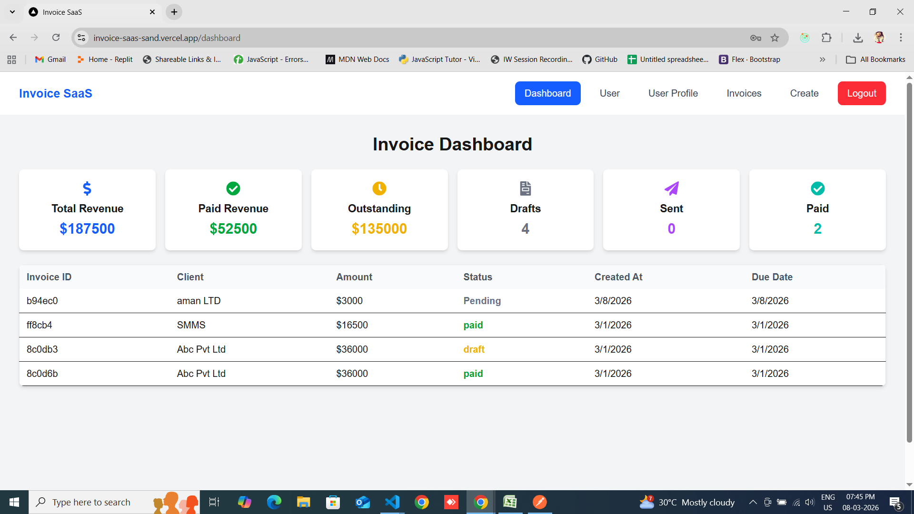

🚀 Invoice SaaS – Multi-Tenant Cloud-Based Invoicing Platform

<strong>A Modern, Secure & Scalable Invoice Management Platform</strong>

📌 Overview

Invoice SaaS is a full-stack, multi-tenant cloud-based invoicing platform designed to simplify invoice management for businesses and organizations.

Built using modern web technologies, the application follows scalable software architecture principles, implementing secure authentication, organization-level data isolation, and role-based access control (RBAC).

The platform supports multiple organizations, allowing each organization to manage its invoices and users within an isolated environment.

This project demonstrates practical implementation of real-world SaaS concepts, backend architecture, database design, authentication, and deployment workflows.

✨ Key Features
🔐 Authentication & Security
Secure user registration and login
Password hashing using bcrypt
JWT-based authentication
Protected API endpoints
Role-based authorization
Secure environment variable management
🏢 Multi-Tenant Architecture
Multiple organizations supported within one application
Organization-based user management
Data isolation using organizationId
Tenant-aware database queries
Secure access to organization-specific resources
👥 Role-Based Access Control

The application supports different user roles with separate access permissions.

Feature	Admin	Staff
View Dashboard	✅	✅
Create Invoice	✅	✅
View Invoices	All	Permission-based
Edit Invoice	✅	Permission-based
Delete Invoice	✅	❌
Manage Customers	✅	Permission-based
Manage Staff	✅	❌
Organization Settings	✅	❌
View Reports	✅	Permission-based

Permissions can be configured according to the organization's business requirements.

🧾 Invoice Management
Create, edit, and delete invoices
Automatic subtotal, tax, and total calculations
Invoice status management (Paid / Unpaid)
Organization-specific invoice records
Role-based invoice access
Invoice tracking and management
⚙️ DevOps & Deployment
Dockerized backend application
MongoDB Atlas cloud database integration
Environment-based configuration
Production-oriented project structure
Deployment-ready frontend architecture
CI/CD integration readiness
🏗 System Architecture

The application follows a modern client-server architecture with a RESTful API backend.

text
              CLIENT
                |
                ▼
       Next.js Frontend
        (TypeScript)
                |
                ▼
          REST API
                |
                ▼
      Node.js + Express
          Backend
                |
       ┌────────┴────────┐
       ▼                 ▼
 Authentication    RBAC Middleware
       |                 |
       └────────┬────────┘
                |
                ▼
        Mongoose ODM
                |
                ▼
         MongoDB Atlas
          Cloud Database

Architecture Highlights
Frontend: Handles user interfaces, authentication flows, and dashboard experiences.
Backend: Manages business logic, API endpoints, and application services.
Authentication: Verifies users through JWT-based authentication.
Authorization: Restricts resources based on user roles and permissions.
Database: Stores organization-specific users, invoices, and related records.
Docker: Provides a consistent backend runtime environment.
🧠 Multi-Tenant Data Flow

Each organization has its own isolated data environment within the shared database infrastructure.

text
                 Invoice SaaS
                      |
          ┌───────────┴───────────┐
          ▼                       ▼
     Organization A         Organization B
          |                       |
     ┌────┴────┐             ┌────┴────┐
     ▼         ▼             ▼         ▼
   Admin     Staff          Admin     Staff
     |         |             |         |
     └────┬────┘             └────┬────┘
          ▼                       ▼
    Company A Data           Company B Data

Every authenticated request is validated against the user's organization context to prevent unauthorized cross-tenant data access.

🛠 Technology Stack
Category	Technologies
Frontend	Next.js, TypeScript
UI Styling	Tailwind CSS
Backend	Node.js, Express.js
Database	MongoDB Atlas
ODM	Mongoose
Authentication	JWT
Password Security	bcrypt
Containerization	Docker
Frontend Deployment	Vercel
Version Control	Git & GitHub
📂 Project Structure
text
invoice-saas/
│
├── backend/
│   ├── src/
│   │   ├── config/
│   │   ├── controllers/
│   │   ├── middleware/
│   │   ├── models/
│   │   ├── routes/
│   │   ├── services/
│   │   ├── utils/
│   │   └── app.js
│   │
│   ├── Dockerfile
│   ├── server.js
│   └── package.json
│
├── frontend/
│   ├── app/
│   ├── components/
│   ├── hooks/
│   ├── services/
│   ├── types/
│   ├── utils/
│   └── package.json
│
├── .gitignore
└── README.md

The structure above represents the intended architectural organization; adjust it to match the actual repository.

🚀 Getting Started

Follow these steps to run the application locally.

1. Clone the Repository
bash
git clone <>
cd invoice-saas

2. Backend Setup
bash
cd backend
npm install

Create a .env file inside the backend directory:

env
PORT=5000
MONGODB_URI=your_mongodb_connection_string
JWT_SECRET=your_secure_jwt_secret
NODE_ENV=development

Start the backend:

bash
npm run dev

3. Frontend Setup

Open another terminal:

bash
cd frontend
npm install

Configure your frontend environment variables in .env.local:

env
NEXT_PUBLIC_API_URL=http://localhost:5000

Start the frontend:

bash
npm run dev

4. Open the Application

Visit:

text
http://localhost:3000

Note: Ensure your backend scripts and environment variable names match your actual project configuration.

🐳 Docker Support

The backend is containerized using Docker to ensure consistent development and deployment environments.

Build the Docker image:

bash
docker build -t invoice-saas-backend ./backend

Run the container:

bash
docker run -p 5000:5000 --env-file backend/.env invoice-saas-backend

🔒 Security Considerations

Security is an important part of a multi-tenant SaaS platform.

The application is designed around the following principles:

Passwords are stored using secure hashing.
JWT tokens are used for authentication.
Protected routes require valid authentication.
Role-based middleware controls access to resources.
Organization-level filtering prevents cross-tenant data exposure.
Sensitive configuration values are stored in environment variables.
Backend authorization is enforced independently of frontend visibility.
🔮 Future Enhancements

The platform can be extended with additional SaaS capabilities:

PDF invoice generation and downloads
Automated invoice email notifications
Payment gateway integration
Advanced analytics and reporting
Recurring invoices
Invoice reminders and notifications
Redis caching
Advanced staff permission management
Audit logs and activity tracking
Kubernetes-based deployment
Automated testing and CI/CD pipelines
☁️ Deployment Architecture
Component	Deployment
Frontend	Vercel
Backend	Docker-compatible cloud hosting
Database	MongoDB Atlas
Source Code	GitHub
👩‍💻 Author

Ansu Kumari

Full Stack Developer | React | Next.js | Node.js | AWS

Interested in building scalable web applications, modern SaaS platforms, and cloud-based solutions.

⭐ Project Highlights

This project demonstrates hands-on experience with:

Full-stack application development
Multi-tenant SaaS architecture
Role-Based Access Control (RBAC)
Secure authentication and authorization
RESTful API development
MongoDB schema design
Docker containerization
Cloud database integration
Scalable backend architecture
Production-oriented application development

<strong>Built with ❤️ to explore and demonstrate modern SaaS engineering.</strong>

⭐ If you find this project interesting, consider giving it a star!

